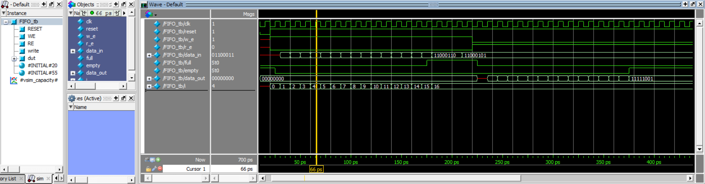
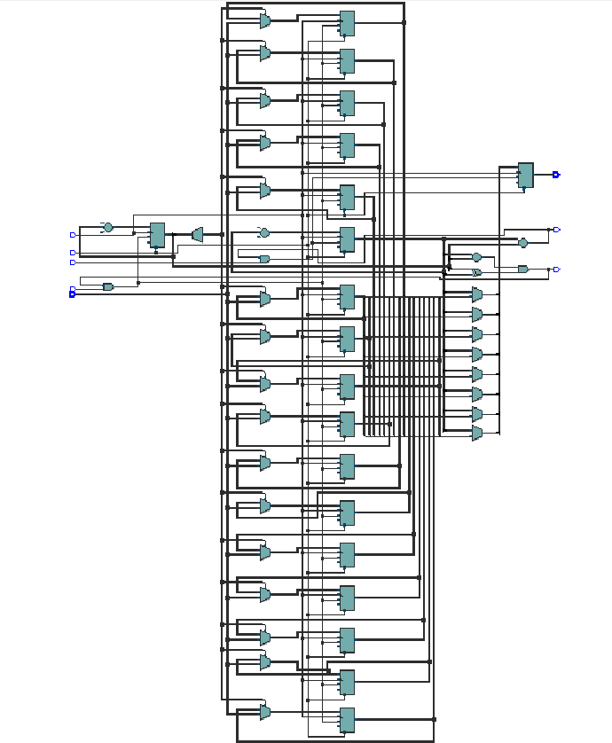
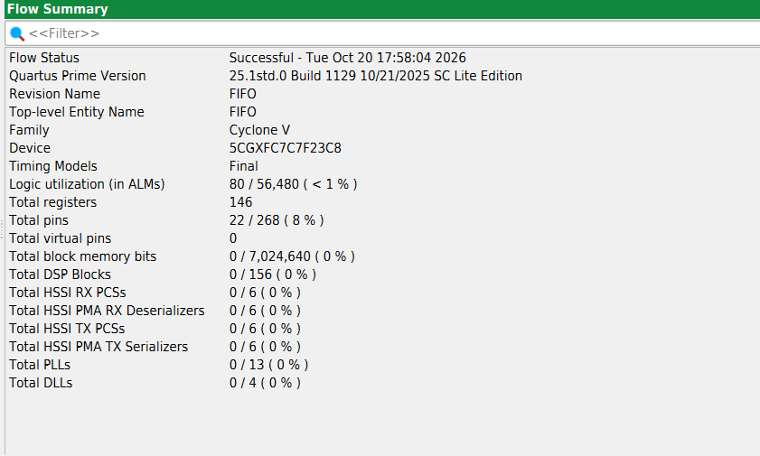

# Verilog Memory Design and FIFO

A Verilog HDL project exploring memory architectures and digital design, with a primary focus on **FIFO (First-In, First-Out) design, memory depth calculation, circular pointers, functional verification, and synthesis**.

The FIFO design is verified using **ModelSim** and synthesized using **Intel Quartus Prime**.

## Project Overview

This repository contains Verilog implementations of memory-related modules to understand how data is stored, accessed, and transferred in digital systems.

The main highlight is an **8-bit-wide, 16-entry FIFO**, covering memory capacity calculation, address width, pointer wrap-around, full and empty detection, simulation, and synthesis.

## FIFO Design

A FIFO (First-In, First-Out) is a memory structure in which the first data written is the first data read.

It is commonly used for data buffering, temporary storage, and communication between digital hardware blocks operating at different rates.

### FIFO Specifications

| Parameter | Value |
|---|---|
| Data width | 8 bits |
| FIFO depth | 16 entries |
| Memory organization | 16 × 8 |
| Total storage capacity | 128 bits |
| Read pointer width | 5 bits |
| Write pointer width | 5 bits |
| Simulation tool | ModelSim |
| Synthesis tool | Intel Quartus Prime |

## FIFO Depth Calculation

FIFO depth represents the number of data entries that can be stored at one time.

### 1. Total Memory Capacity

The total storage capacity is calculated as:

**Total Capacity = FIFO Depth × Data Width**

For this design:

- FIFO depth = 16 entries
- Data width = 8 bits

Therefore:

**Total Capacity = 16 × 8 = 128 bits**

The FIFO can store 16 data words, with each word containing 8 bits.

### 2. Address Width Calculation

The address width determines how many bits are required to select a memory location.

**Address Width = log₂(FIFO Depth)**

For a FIFO depth of 16:

**Address Width = log₂(16) = 4 bits**

Four address bits can represent 16 unique locations, from address 0 to address 15.

### 3. Why Are 5-Bit Pointers Required?

Although the FIFO contains 16 memory locations, its read and write pointers are 5 bits wide.

The extra bit is used to track pointer wrap-around and distinguish between full and empty conditions.

- **Lower 4 bits:** Select one of the 16 memory locations.
- **Extra bit:** Tracks whether the pointer has wrapped around.
- **Empty condition:** The complete read and write pointers are equal.
- **Full condition:** The lower 4 pointer bits are equal, but the extra bits differ.

This technique allows the FIFO to distinguish a completely full buffer from an empty buffer, even when both pointers refer to the same memory address.

> Note: These full and empty conditions assume a conventional circular FIFO design using an extra wrap bit. The RTL must implement the corresponding comparisons correctly.

## FIFO Architecture and Operation

The FIFO uses memory storage along with read and write pointers to manage data movement.

### Write Operation

1. Input data is presented to the FIFO.
2. When a write is accepted, the data is stored at the write pointer's memory address.
3. The write pointer advances to the next location.
4. The pointer wraps around when it reaches the end of the memory.

### Read Operation

1. When a read is accepted, the data at the read pointer's memory address is retrieved.
2. The read pointer advances to the next location.
3. Data is read in the same order in which it was written.

### Full and Empty Detection

- The empty flag indicates that no unread data is available.
- The full flag indicates that the FIFO has reached its storage capacity.
- Read and write control logic must prevent invalid operations when the FIFO is empty or full, according to the design's specified behavior.

## FIFO Simulation — ModelSim

The FIFO RTL is verified using a testbench in **ModelSim**.

The simulation is intended to demonstrate:

- Reset behavior
- FIFO write and read operations
- Correct data ordering
- Read and write pointer progression
- Full and empty flag behavior
- Pointer wrap-around

### Simulation Waveform

The following image shows the FIFO simulation waveform.



**Waveform file:** `waveforms/FIFO_simulation.png`

## Synthesis Results — Intel Quartus Prime

The FIFO RTL was successfully synthesized using Intel Quartus Prime
for a Cyclone V FPGA device.

**Key results:**
- Logic utilization: 80 / 56,480 ALMs (< 1%)
- Total registers: 146
- Total pins: 22 / 268 (8%)
- Block memory bits: 0

#### Synthesized Logic Schematic



#### Quartus Prime Flow Summary



## Other Memory and Digital Design Modules

In addition to FIFO, this repository contains other memory-related and sequential logic implementations.

| Module | Description |
|---|---|
| RAM | Asynchronous-read RAM implementation |
| Synchronous RAM | RAM with clocked memory operations |
| Dual-Clock RAM | RAM using separate read and write clocks |
| SISO Shift Register | Serial-In, Serial-Out shift register |
| Clock Buffer | Clock-buffering implementation |

Refer to the `rtl/` directory for the Verilog source files and the `tb/` directory for available testbenches.

## Repository Structure

```text
Verilog-Memory-Design-and-FIFO/
├── rtl/          # Verilog RTL modules
├── tb/           # Testbench files
├── sim/          # Simulation-related files
├── waveforms/    # FIFO simulation waveform screenshots
├── synthesis/    # FIFO synthesis result screenshots
├── LICENSE
└── README.md
```

## Tools and Technologies

- **HDL:** Verilog
- **Simulation:** ModelSim
- **Synthesis:** Intel Quartus Prime
- **Verification:** Testbench-based functional simulation
- **Design domains:** RTL Design, Digital Logic, Memory Design

## Key Learning Outcomes

- Understanding memory organization and storage capacity
- Calculating FIFO depth, data width, and address width
- Understanding circular read and write pointers
- Implementing and analyzing FIFO full and empty detection
- Exploring different RAM architectures
- Verifying RTL functionality through simulation waveforms
- Understanding the RTL-to-synthesis workflow

## Future Improvements

- Add self-checking testbenches and assertions
- Extend testing for boundary conditions and pointer wrap-around
- Document synthesis resource utilization and timing results
- Explore FPGA implementation and hardware validation

---

**Project Focus:** FIFO Design | Verilog HDL | RTL Design | Memory Architecture | ModelSim | Intel Quartus Prime
